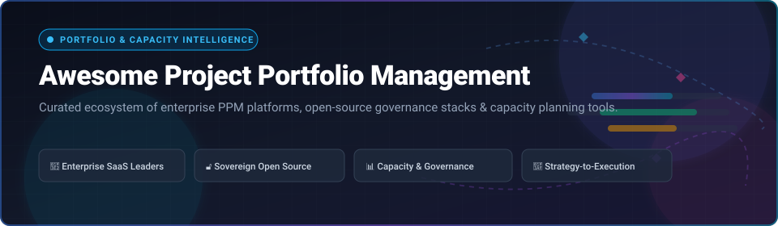

<div align="center">



# 🚀 Awesome Project Portfolio Management (PPM)

**A curated directory of top-tier SaaS platforms, sovereign open-source projects, and enterprise tools for Strategic Portfolio Management (SPM), PMO governance, and resource capacity planning.**

<p align="center">
  <a href="https://github.com/ishandttta2007/Awesome-Awesome-Awesome"></a><a href="https://discord.gg/jc4xtF58Ve"></a>
  <a href="https://github.com/ishandutta2007/Awesome-Project-Portfolio-Management-PPM/stargazers"></a>
  <a href="https://github.com/ishandutta2007/Awesome-Project-Portfolio-Management-PPM/network/members"></a>
  <a href="https://github.com/ishandutta2007/Awesome-Project-Portfolio-Management-PPM/pulls"></a>
  <a href="LICENSE"></a>
  <a href="https://github.com/ishandutta2007"></a>
</p>

</div>

---

## 📑 Table of Contents

- [🌟 Overview](#-overview)
- [📊 Sector Overview & Market Dynamics](#-sector-overview--market-dynamics)
- [🏢 Enterprise SaaS Comparison Table](#-enterprise-saas-comparison-table)
  - [SaaS Deep-Dive Profiles](#saas-deep-dive-profiles)
- [🔓 Open-Source GitHub Projects](#-open-source-github-projects)
  - [Self-Hosted PPM Architectural Blueprint](#self-hosted-ppm-architectural-blueprint)
- [🔍 Core Capability Matrix](#-core-capability-matrix)
- [🤝 How to Contribute](#-how-to-contribute)
- [⭐ Star History](#-star-history)
- [💖 Support & Sponsoring](#-support--sponsoring)
- [⚖️ Disclaimer](#️-disclaimer)

---

## 🌟 Overview

**Project Portfolio Management (PPM)** software empowers Project Management Offices (PMOs), enterprise leaders, and portfolio directors to align complex project investments with overarching business strategy. Whether managing capital expenditure pipelines, resource capacity bottlenecks, or hybrid agile/waterfall execution, PPM tooling provides continuous visibility into project health, financial burn rates, and strategic ROI.

This guide tracks leading **enterprise commercial SaaS platforms** and **active open-source GitHub repositories**, tailored for technology leaders evaluating software for sovereign data hosting, team scale, and budget.

---

## 📊 Sector Overview & Market Dynamics

The global **Project Portfolio Management (PPM)** market was valued at **$5.4 Billion in 2024** and is projected to reach **$11.8 Billion by 2032**, expanding at a Compound Annual Growth Rate (**CAGR of ~10.2%**). This acceleration is fueled by cross-enterprise digital transformations, remote and hybrid workforce distribution, and the mainstream adoption of AI-driven predictive resource leveling.

From a structural perspective, the sector is **moderately fragmented**:
- **Enterprise SPM & Heavy Governance**: High-end strategic PPM remains anchored by entrenched mega-caps such as **Microsoft**, **Broadcom Clarity**, **ServiceNow**, and **Planview**, which dominate Fortune 500 capital portfolio planning and compliance-heavy IT portfolios.
- **Collaborative Work Management (CWM) Expansion**: High-growth challengers like **Monday.com**, **Smartsheet**, **Asana**, **ClickUp**, and **Atlassian** continue encroaching upward into PMO territory with flexible, API-rich portfolio rollups.
- **Sovereign & Self-Hosted Wave**: Data privacy mandates (GDPR, HIPAA, BSI IT-Grundschutz) and per-seat license fatigue are accelerating adoption of sovereign open-source platforms like **OpenProject**, **Plane**, and **Leantime** across government, healthcare, and security-conscious enterprises.

---

## 🏢 Enterprise SaaS Comparison Table

The table below outlines the premier SaaS PPM platforms, **sorted in descending order by company scale** (Market Capitalization or Valuation):

| 🏢 Platform / Product | 📈 Company Scale (Valuation / Revenue) | 💳 Starting Pricing | 🎁 Free Tier / Free Trial Limits | 🎯 Primary PPM & Governance Focus |
| :--- | :--- | :--- | :--- | :--- |
| **[Microsoft Project & Planner](https://www.microsoft.com/en-us/microsoft-365/project/project-management-software)** | **$3.12 Trillion** Market Cap *(~$245.1B FY24 Revenue)* | **$10.00** / user / month *(Planner Plan 1 / Project Plan 1)* | **30-day free trial** *(up to 25 full Enterprise user licenses)* | Enterprise portfolio scheduling, resource capacity allocation, Power BI dashboards, and Microsoft 365 Copilot integration. |
| **[Broadcom Clarity](https://www.broadcom.com/products/software/value-stream-management/clarity)** | **$845 Billion** Market Cap *(~$51.6B FY24 Revenue)* | **$35.00** / user / month *(enterprise deployment baseline, billed annually)* | **30-day enterprise sandbox trial** *(upon sales qualification; no self-serve free tier)* | Strategic Portfolio Management (SPM), investment funding prioritization, financial controls, and value stream management. |
| **[ServiceNow SPM](https://www.servicenow.com/)** | **$195 Billion** Market Cap *(~$11.0B FY24 Revenue)* | **$55.00** / user / month *(Enterprise baseline, contract minimums apply)* | **Indefinite free Personal Developer Instance (PDI)** *(with SPM plugins enabled; requires 10-day activity)* | Strategy-to-execution alignment, enterprise demand management, hybrid agile/waterfall governance, and ITSM linkage. |
| **[Atlassian Jira](https://www.atlassian.com/software/jira)** | **$52 Billion** Market Cap *(~$4.4B FY24 Revenue)* | **$7.15** / user / month *(Standard) / **$12.48** (Premium with Advanced Roadmaps)* | **Free forever for up to 10 users** *(2 GB storage, Scrum/Kanban boards); **14-day free trial** for Premium* | Cross-project agile portfolio roadmaps, team dependency tracking, capacity planning, and Jira Align SAFe scaling. |
| **[Monday.com](https://monday.com/)** | **$15.2 Billion** Market Cap *(~$972M FY24 Revenue)* | **$9.00** / seat / month *(Basic, 3-seat min = $27/mo; Pro with Portfolio is $19/mo)* | **Free forever for up to 2 seats** *(up to 3 boards, 200 items, 500MB storage); **14-day free trial** for Pro* | Visual multi-project portfolio rollups, workload capacity balancing, baseline Gantt charts, and custom workflow automations. |
| **[Smartsheet](https://www.smartsheet.com/)** | **$8.4 Billion** Valuation *(Blackstone/Vista acquisition, ~$1.1B ARR)* | **$9.00** / member / month *(Pro, max 10 users) / **$19.00** (Business, 3-seat min)* | **Free forever for 1 user & up to 2 sheets** *(up to 2 editors, 500MB storage); **30-day free trial** for Business* | Sheet-driven portfolio rollups, Control Center portfolio blueprints, Resource Management, and cross-project reporting. |
| **[ClickUp](https://clickup.com/)** | **$4.0 Billion** Valuation *(Private Series C, ~$200M+ ARR)* | **$7.00** / user / month *(Unlimited, billed annually) / **$12.00** (Business)* | **Free forever for unlimited users** *(100MB storage, 100 uses of Portfolio views); **14-day free trial** for Business* | Portfolio rollup views, strategic goal tracking, workload capacity management, custom status automations, and docs. |
| **[Asana](https://asana.com/)** | **$3.2 Billion** Market Cap *(~$652M FY24 Revenue)* | **$10.99** / user / month *(Starter) / **$24.99** (Advanced with Portfolios & Workload)* | **Free forever for up to 10 users** *(unlimited tasks, projects, 100MB file limit); **30-day free trial** for Advanced* | Strategic portfolio tracking, OKR and goal hierarchies, cross-team workload capacity leveling, and timeline dependencies. |
| **[Wrike](https://www.wrike.com/)** | **$2.25 Billion** Valuation *(Private STG acquisition, ~$220M ARR)* | **$9.80** / user / month *(Team, 2–25 users) / **$24.80** (Business, billed annually)* | **Free forever for unlimited users** *(basic task management, 2GB storage, board views); **14-day free trial** for Business* | Multi-level portfolio folder hierarchies, interactive Gantt charts, real-time workload balancing, and intake request forms. |
| **[Planview](https://www.planview.com/)** | **$1.6 Billion** Valuation *(Private TPG/TA Associates, ~$450M ARR)* | **$25.00** / user / month *(AdaptiveWork / AgilePlace baseline, billed annually)* | **30-day free trial for AgilePlace / AdaptiveWork** *(full sandbox functionality, 5 workspaces; no permanent free tier)* | Enterprise Strategic Portfolio Management (SPM), scenario capacity modeling, financial governance, and OKR alignment. |

### SaaS Deep-Dive Profiles

- **[Microsoft Project & Planner](https://www.microsoft.com/en-us/microsoft-365/project/project-management-software)**: The bedrock of enterprise project scheduling. With the unified Microsoft Planner experience, it connects desktop-grade Gantt planning (Project Plan 3/5) with collaborative board views, Power BI portfolio analytics, and automated Microsoft Power Automate flows.
- **[Broadcom Clarity](https://www.broadcom.com/products/software/value-stream-management/clarity)**: The standard-bearer for traditional IT PMOs and strategic investment planning. Excels at complex capital and operating expenditure (CapEx/OpEx) accounting, audit compliance, and Value Stream Management across global enterprise divisions.
- **[ServiceNow Strategic Portfolio Management (SPM)](https://www.servicenow.com/)**: Bridges strategic business goals with IT execution on the Now Platform. Automates demand intake, project scoring, resource demand forecasting, and links delivery directly to IT Service Management (ITSM) and CMDB assets.
- **[Atlassian Jira](https://www.atlassian.com/software/jira)**: Enables multi-team agile release planning via Advanced Roadmaps and Jira Align. Connects high-level strategic epics with real-time sprint execution across hundreds of development squads.
- **[Monday.com](https://monday.com/)**: Combines high adaptability with executive portfolio visibility. Provides high-level dashboards that roll up data from dozens of connected sub-boards, tracking real-time status, budget burns, and human resource allocation.
- **[Smartsheet](https://www.smartsheet.com/)**: Bridges familiar spreadsheet mental models with automated portfolio governance. Smartsheet Control Center allows PMOs to provision standardized project templates with automatic rollup into portfolio summary sheets.
- **[ClickUp](https://clickup.com/)**: All-in-one productivity suite providing hierarchical portfolio views, custom status rollups, native time tracking, and strategic goal targets for fast-moving startups and agencies.
- **[Asana](https://asana.com/)**: Best-in-class UI for strategic initiatives. Provides portfolio health rollups, real-time workload balancing across departments, and executive goal progress tracking.
- **[Wrike](https://www.wrike.com/)**: Purpose-built for complex marketing, creative, and professional services PMOs requiring deep cross-project dependencies, resource leveling, and automated client intake workflows.
- **[Planview (AdaptiveWork / Portfolios)](https://www.planview.com/)**: Enterprise SPM and work management platform engineered to model complex "what-if" capacity scenarios, balance strategic trade-offs, and steer investments from idea to value realization.

---

## 🔓 Open-Source GitHub Projects

Discover active, self-hostable open-source solutions for PPM, collaborative work tracking, and sovereign project governance. **Sorted in descending order by GitHub Stars:**

1. **[AppFlowy](https://github.com/AppFlowy-IO/AppFlowy)** [](https://github.com/AppFlowy-IO/AppFlowy/stargazers)  
   *AI Collaborative Workspace & Multi-Project Knowledge Hub*  
   **License:** AGPL-3.0 | **Tech Stack:** Flutter, Rust  
   Open-source alternative to Notion and Asana. Enables teams to organize multi-project databases, Kanban boards, milestone roadmaps, and project documentation with 100% data sovereignty and offline-first capabilities.

2. **[Plane](https://github.com/makeplane/plane)** [](https://github.com/makeplane/plane/stargazers)  
   *Modern Open-Source Work & Agile Project Management Platform*  
   **License:** AGPL-3.0 | **Tech Stack:** TypeScript, Python, Django, Next.js  
   Engineered as an open alternative to Jira, Linear, and Monday. Features multi-project workspaces, sprint cycles, roadmap modules, time estimates, triage workflows, and five customizable layout views (List, Board, Spreadsheet, Gantt, Calendar).

3. **[Huly](https://github.com/hcengineering/platform)** [](https://github.com/hcengineering/platform/stargazers)  
   *All-in-One Open-Source Project & Team Workspace*  
   **License:** EPL-2.0 | **Tech Stack:** TypeScript, Node.js  
   Next-generation digital workspace unifying project management, issue tracking, roadmaps, docs, team messaging, and virtual office presence into a cohesive self-hosted platform.

4. **[Focalboard](https://github.com/mattermost/focalboard)** [](https://github.com/mattermost/focalboard/stargazers)  
   *Self-Hosted Multilingual Project & Task Tracking Platform*  
   **License:** MIT / AGPL-3.0 | **Tech Stack:** Go, TypeScript, React  
   Maintained by Mattermost as an open alternative to Trello, Notion, and Asana. Provides visual boards, table filters, calendar scheduling, and team permissions for coordinating cross-functional projects.

5. **[OpenProject](https://github.com/opf/openproject)** [](https://github.com/opf/openproject/stargazers)  
   *Enterprise Open-Source Project Portfolio Management (PPM) Standard*  
   **License:** GPL-3.0 | **Tech Stack:** Ruby on Rails, Angular, PostgreSQL  
   The premier open-source PPM solution featuring complete portfolio hierarchies, interactive Gantt timelines, resource capacity leveling, budget and cost tracking, agile boards, and strict GDPR / BSI IT-Grundschutz data sovereignty compliance.

6. **[Planka](https://github.com/plankanban/planka)** [](https://github.com/plankanban/planka/stargazers)  
   *Real-Time Collaborative Kanban Project Tracker*  
   **License:** AGPL-3.0 | **Tech Stack:** Node.js, React, PostgreSQL  
   Clean, responsive Kanban platform for team project tracking. Supports multi-project organizations, customizable boards, checklist progress, file attachments, and granular user roles.

7. **[Grist](https://github.com/gristlabs/grist-core)** [](https://github.com/gristlabs/grist-core/stargazers)  
   *Relational Spreadsheet-Database Hybrid for Custom PPM Rollups*  
   **License:** Apache-2.0 | **Tech Stack:** Python, TypeScript, SQLite  
   Combines the intuitive layout of spreadsheets with the power of relational databases. Ideal for creating custom portfolio summary views, resource allocation grids, and CapEx/OpEx financial rollups backed by portable SQLite files.

8. **[Leantime](https://github.com/Leantime/leantime)** [](https://github.com/Leantime/leantime/stargazers)  
   *Goal-Oriented Strategic Project Management System*  
   **License:** AGPL-3.0 | **Tech Stack:** PHP, JavaScript, MySQL  
   Tailored for non-PMP managers and neurodivergent teams. Unifies strategic OKRs, Lean business canvas modeling, milestone Gantt roadmaps, idea backlog scoring, and sprint execution.

9. **[Kanboard](https://github.com/kanboard/kanboard)** [](https://github.com/kanboard/kanboard/stargazers)  
   *Minimalist & Fast Open-Source Kanban Management*  
   **License:** MIT | **Tech Stack:** PHP, SQLite/MySQL/PostgreSQL  
   Lightweight Kanban system focused on speed and simplicity. Features multi-project analytics, custom swimlanes, subtasks, automated board actions, and Gantt charts without infrastructure overhead.

10. **[Kaneo](https://github.com/usekaneo/kaneo)** [](https://github.com/usekaneo/kaneo/stargazers)  
    *Distraction-Free Agile Project Tracking Platform*  
    **License:** MIT | **Tech Stack:** TypeScript, Vue.js, Node.js  
    Modern, streamlined project workspace designed for lean teams. Offers intuitive sprint boards, milestone timelines, automated notifications, and seamless team collaboration.

11. **[Redmine](https://github.com/redmine/redmine)** [](https://github.com/redmine/redmine/stargazers)  
    *Veteran Multi-Project Management & Issue Tracking Framework*  
    **License:** GPL-2.0 | **Tech Stack:** Ruby on Rails, MySQL/PostgreSQL  
    Proven multi-project web platform with built-in Gantt charts, calendar schedules, issue tracking, role-based access control, time logging, and an extensive catalog of community PPM and Agile plugins.

12. **[Vikunja](https://github.com/go-vikunja/vikunja)** [](https://github.com/go-vikunja/vikunja/stargazers)  
    *Clean Self-Hosted Task & Project Manager*  
    **License:** AGPL-3.0 | **Tech Stack:** Go, Vue.js  
    Fast, modern project tracker built for self-hosters. Delivers Kanban, Gantt, list, and table views, project namespaces for grouping portfolios, labels, subtasks, and an open REST API.

13. **[Kan.bn](https://github.com/kanbn/kan)** [](https://github.com/kanbn/kan/stargazers)  
    *Developer-Centric Kanban Platform with Trello Import*  
    **License:** AGPL-3.0 | **Tech Stack:** TypeScript, Node.js  
    Lightweight, developer-friendly project board tool offering board privacy levels, custom columns, markdown cards, and one-click data migration from Trello.

14. **[Taiga](https://github.com/taigaio/taiga-docker)** [](https://github.com/taigaio/taiga-docker/stargazers)  
    *Agile Management Platform for Scrum & Kanban Teams*  
    **License:** MPL-2.0 / GPL-3.0 | **Tech Stack:** Python, Django, AngularJS  
    Award-winning agile management tool built for startups and cross-functional engineering teams. Features Scrum sprint planning, burndown metrics, Kanban workflow boards, and multi-project epics.

15. **[LibrePlan](https://github.com/LibrePlan/libreplan)** [](https://github.com/LibrePlan/libreplan/stargazers)  
    *Web-Based Enterprise Project Portfolio Planning & Capacity Management*  
    **License:** AGPL-3.0 | **Tech Stack:** Java, ZK Framework  
    Dedicated enterprise open-source tool for PPM and resource management. Provides Work Breakdown Structures (WBS), Critical Path Method (CPM) scheduling, resource constraint leveling, and project governance logs.

16. **[ProjectLibre](https://github.com/smartqubit/projectlibre)** [](https://github.com/smartqubit/projectlibre/stargazers)  
    *Open-Source Desktop Microsoft Project Alternative*  
    **License:** CPAL-1.0 | **Tech Stack:** Java  
    Desktop application compatible with Microsoft Project `.mpp` files. Features comprehensive Gantt scheduling, PERT network diagrams, Earned Value Costing (EVM), and resource assignment matrixes.

### Self-Hosted PPM Architectural Blueprint

For organizations building an enterprise-ready sovereign PPM stack without per-seat licensing fees:

```
┌──────────────────────────────────────────────────────────────────┐
│                   EXECUTIVE & PMO GOVERNANCE                     │
│  • Strategic OKRs & Roadmaps       • Enterprise Portfolios       │
│  (OpenProject / Leantime)          (OpenProject Enterprise)      │
├──────────────────────────────────────────────────────────────────┤
│                 RESOURCE & FINANCIAL PLANNING                    │
│  • Capacity Constraint Leveling    • CapEx / OpEx Budget Rollups │
│  (LibrePlan / OpenProject)         (Grist Relational Engine)     │
├──────────────────────────────────────────────────────────────────┤
│                   TEAM-LEVEL AGILE EXECUTION                     │
│  • Sprint Cycles & Work Items      • Visual Kanban Tracking      │
│  (Plane / Huly)                    (Planka / Focalboard)         │
└──────────────────────────────────────────────────────────────────┘
```

---

## 🔍 Core Capability Matrix

| Capability Area | Enterprise PPM Focus | Leading SaaS Choices | Open-Source Champions |
| :--- | :--- | :--- | :--- |
| **Strategic Portfolio Planning** | Long-term roadmap alignment, investment scoring, and scenario analysis | ServiceNow SPM, Broadcom Clarity, Planview | OpenProject, Leantime |
| **Resource Capacity Planning** | Workload balancing, skill matrix modeling, and utilization forecasting | Microsoft Project, Asana, Smartsheet | LibrePlan, OpenProject |
| **Cross-Project Aggregation** | Multi-board rollups, consolidated milestones, and executive dashboards | Monday.com, ClickUp, Wrike | Grist, Plane |
| **Agile & Hybrid Execution** | Sprints, Epics, Kanban, Gantt, and backlog prioritization | Atlassian Jira, Monday Dev | Plane, Huly, Taiga |
| **Sovereignty & Compliance** | Air-gapped hosting, on-premises deployment, and zero vendor lock-in | Dedicated FedRAMP/GovCloud tiers | OpenProject, Grist, AppFlowy |

---

## 🤝 How to Contribute

Contributions are welcome! Help maintain this curated PPM directory:

1. 🍴 **Fork the repository** to your GitHub account.
2. 🌿 **Create a feature branch**:
   ```bash
   git checkout -b add-new-ppm-tool
   ```
3. 📝 **Add or update entries**: Ensure to follow the established format:
   - For SaaS: Name, Company Scale, Starting Price, Free Tier/Trial limits, and Core Capabilities.
   - For Open Source: Name, Star Badge linked to stargazers, License, Tech Stack, and Factual Description.
4. 📬 **Submit a Pull Request (PR)** with a clear title and description of your additions.

---

## ⭐ Star History

[](https://star-history.dera.page/#ishandutta2007/Awesome-Project-Portfolio-Management-PPM&type=date&legend=top-left)

---

## 💖 Support & Sponsoring

Thank you for visiting and utilizing this curated Project Portfolio Management ecosystem guide! If this resource has helped you evaluate PPM software, streamline PMO governance, or discover sovereign open-source alternatives:

- ⭐ **Star this repository** to improve visibility and help other leaders discover it.
- 🍴 **Fork and contribute** to keep pricing and feature matrices accurate.
- 📢 **Share with colleagues** across PMO, DevOps, and engineering leadership communities.
- ☕ **Support maintenance and curation**: If you would like to buy a coffee or sponsor ongoing research, please visit the **[GitHub Sponsors Dashboard](https://github.com/sponsors/ishandutta2007)**.

Your encouragement and support keep this ecosystem open and accessible for everyone! 🙌

---

## ⚖️ Disclaimer

- This repository is a **community-curated informational list** — inclusion does not constitute a commercial endorsement.
- All product names, logos, and brands are property of their respective owners.
- Pricing, free tier limits, and feature sets are subject to vendor updates; please verify directly on the official vendor websites before procurement decisions.

---

<div align="center">
  <sub>Maintained with ❤️ by <a href="https://github.com/ishandutta2007">Ishan Dutta</a> and the open-source community.</sub>
</div>
